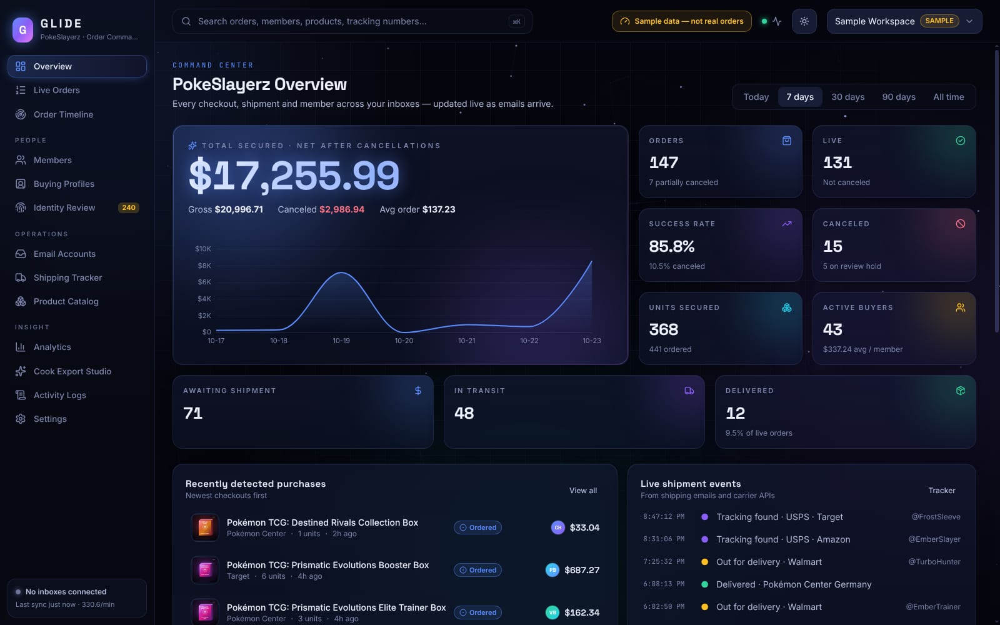
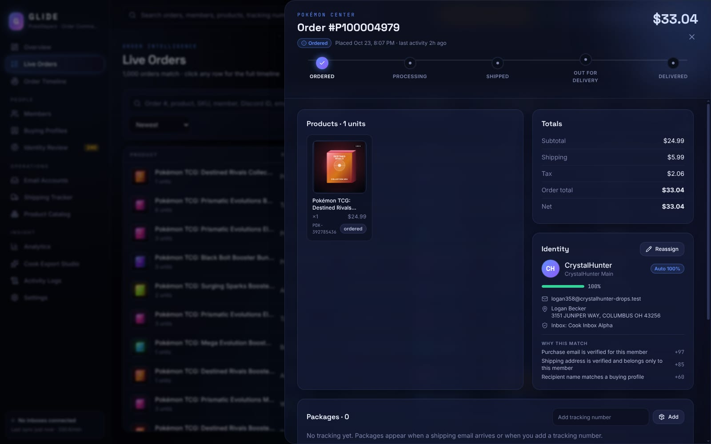
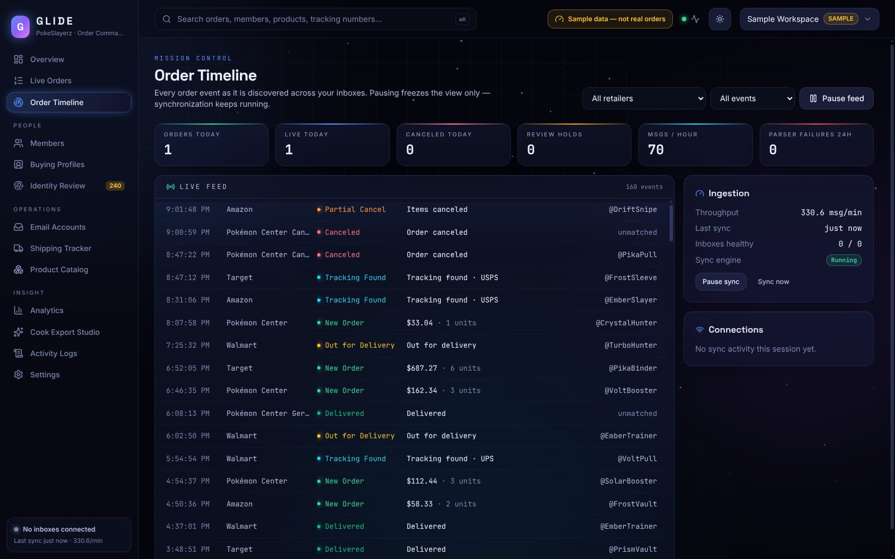
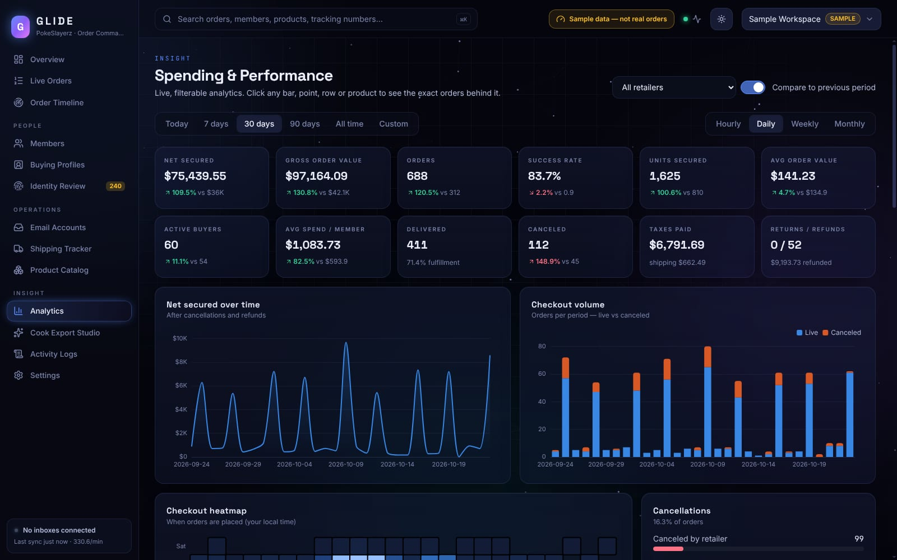
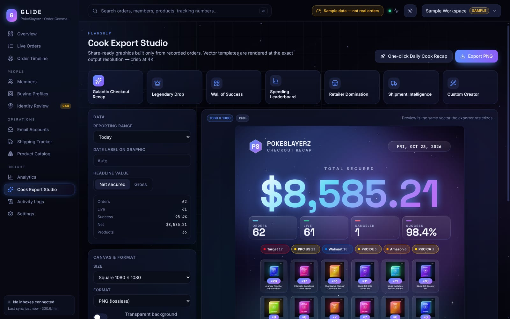
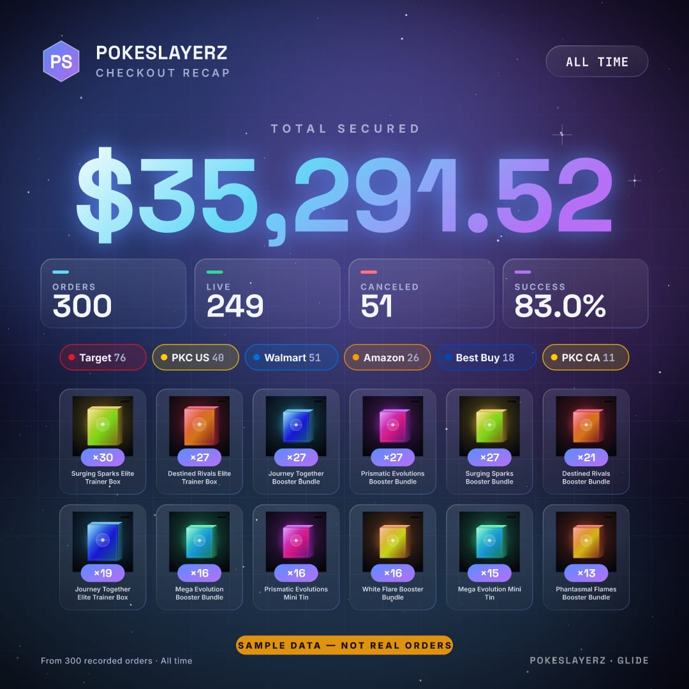
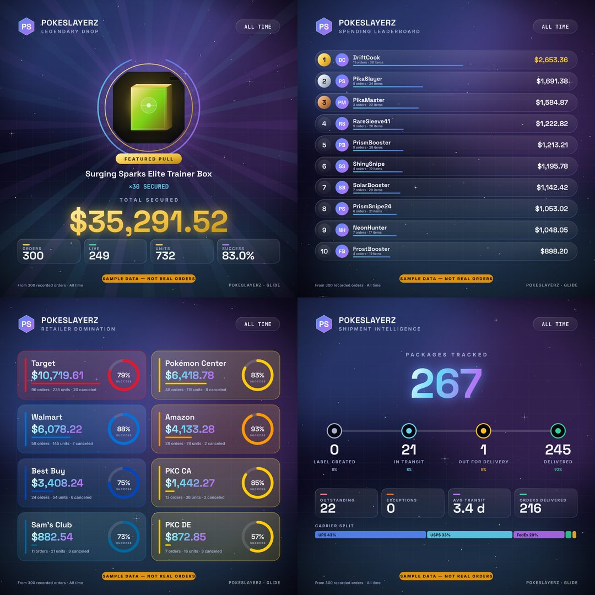

# GLIDE — PokeSlayerz Order Command Center

GLIDE is a desktop app for Windows, macOS and Linux that tracks retail orders across many email inboxes. It matches each order to the right Discord member, follows shipments, reports spending and success rates, and generates share-ready "cook recap" graphics.

Everything runs locally: an Electron app with a local SQLite database. Parsing, identity matching, analytics and image rendering are deterministic and need **no paid AI service**.



| | |
|---|---|
|  |  |
|  |  |

Cook Export Studio output (sample data, rendered by the app at full resolution):

| Galactic Checkout Recap | Legendary Drop · Leaderboard · Retailers · Shipments |
|---|---|
|  |  |

## Quick start

Requires Node.js 22+.

```bash
cd glide
npm install
npm start          # build and launch the desktop app
```

On first launch, the setup wizard offers two paths:

- **Create your workspace**, then connect inboxes, import EML/MBOX history, connect Discord and import profile CSVs.
- **Explore with sample data**: builds a separate, clearly labeled workspace from about 3,200 synthetic retailer emails. They run through the same parsers, deduplication, identity matcher and analytics that real mail uses.

### Commands

| Command | What it does |
|---|---|
| `npm start` | Build everything and launch the app |
| `npm run dev` | Vite hot reload, main-process watch and Electron |
| `npm test` | Unit and acceptance tests (Vitest, 59 tests) |
| `npm run test:e2e` | Builds, then drives the real Electron app with Playwright (18 tests). On a headless Linux box use `xvfb-run -a npm run test:e2e` |
| `npm run test:perf` | Scale test: 100k orders, 10k members, 10k profiles (`GLIDE_PERF_ORDERS` to change) |
| `npm run typecheck` | TypeScript, no emit |
| `npm run dist:win` / `dist:mac` / `dist:linux` | Installers via electron-builder (NSIS / DMG+ZIP / AppImage) into `release/` |
| `npm run cli -- sample out.sqlite` | Headless sample-workspace generator (also `import <db> <eml/mbox/dir>`, `stats <db>`) |

Build each installer on its own OS: macOS for `.dmg`, Windows for NSIS. macOS signing and notarization need your Apple Developer credentials (see electron-builder docs).

## What's in the box

| Area | Implemented |
|---|---|
| **Email ingestion** | IMAP with app passwords, Gmail and Outlook through OAuth 2.0 PKCE plus IMAP XOAUTH2, forwarding inboxes, EML/MBOX/folder import. Incremental per-mailbox UID checkpoints, read-only `EXAMINE` and `BODY.PEEK` (mail is never marked read), retry with backoff, crash-safe resume, optional historical backfill. |
| **Parsing** | Adapters for Target, Walmart, Pokémon Center US/UK/CA/DE, Amazon, Best Buy, Costco, Sam's Club, GameStop, Hot Topic, Barnes & Noble, Macy's, LEGO, Shopify stores, plus user-defined regex templates. Handles confirmation, shipping, out for delivery, delivered, canceled, partial cancel, review hold, backorder, delay, return and refund. Unwraps Gmail, Outlook and Apple Mail forwards and forward-as-attachment. Extracts items (SKU, UPC, image, quantity, price), totals, addresses and tracking numbers (validated with check digits). |
| **Orders** | One canonical order per retailer order number; every source email is kept as provenance. Multiple items, packages and tracking numbers per order. Separate fulfillment, cancellation, financial and review states (a review hold is never treated as a cancellation). Idempotent: the same email arriving directly and through two forwards changes nothing twice. |
| **Identity** | Address normalization (USPS suffixes, directionals, unit designators, states, ZIP5, UK/CA/DE postcodes), Gmail dot/+tag canonicalization, nicknames, private catch-all domains. Noisy-OR confidence from explainable evidence. Auto-links only unique, high-confidence matches; everything else goes to the review queue. Shared households stay separate. Merge, split, reassign and forget, all audited. |
| **Discord** | Bot-token REST integration: member import with stable IDs and username history, avatars, mapping CSV import/export. Notifications only to a private admin channel or the owner's DM, with an outbox, retry and rate-limit handling. |
| **Shipping** | Carrier detection and official tracking links. Optional UPS, FedEx, USPS and DHL APIs with your own credentials. Every status shows when it was last verified. No fabricated milestones. |
| **Analytics** | KPIs, timelines, checkout volume, heatmap, retailer, member, product and profile breakdowns, cancellation breakdown, period comparison, campaign conversion, inactive members. Click any chart element to drill into the exact orders. Multi-currency with configurable FX. |
| **Cook Export Studio** | Seven templates: Galactic Checkout Recap, Legendary Drop, Wall of Success, Spending Leaderboard, Retailer Domination, Shipment Intelligence, and Custom Creator (drag-and-drop with snapping guides). Exports PNG, JPG, WebP, PDF, transparent PNG/WebP, animated GIF, and MP4 when ffmpeg is installed, at any size up to 7680 px, rendered from vector at the exact resolution. Presets, `.glidecook` project files, one-click Daily Cook Recap, masked-name privacy mode, branding and watermark controls. |
| **Product catalog** | Products are identified by SKU or UPC, never by fuzzy title matching. Images come from the retailer's own email and are cached locally. Manual image correction, product merge, and Pokémon format categories. |
| **Automations** | Rules A–I (spending, tracking, identity, cancellations, delivered milestone, daily recap, parser alerts, Discord alerts), each with enable/disable controls and execution history. Each rule runs at most once per event. |
| **CSV** | Column mapper with PokeSlayerz, Valor and Sniped presets plus alias matching. Preview with duplicates and missing-field detection, apply, and rollback. Card numbers, CVVs and expiry columns are never imported. Exports orders (one row per item), member spending and per-member statements (CSV/PDF). |
| **Security & reliability** | Secrets encrypted with AES-256-GCM using a workspace key sealed by the OS keychain (Electron safeStorage). Sandboxed renderer with strict CSP. Encrypted raw-email storage; non-retail mail is never stored. Redacted logs, audit log, automatic rotating backups, restore, full data export, workspace deletion, and "forget member". |
| **First launch** | 10-step wizard, plus a sample-data mode that is clearly labeled and kept in its own database. |

See [docs/ARCHITECTURE.md](docs/ARCHITECTURE.md), [docs/METRICS.md](docs/METRICS.md), [docs/EMAIL_SETUP.md](docs/EMAIL_SETUP.md) and [docs/SECURITY.md](docs/SECURITY.md).

## What has been tested

- **Acceptance scenarios 1–8** are automated: returning buyer, new email, shared household, duplicate forwarding, two-package shipment, partial cancellation, recap export at multiple resolutions with exact aggregation checks, and restart mid-sync (fake IMAP server, crash injection, UIDVALIDITY reset).
- **Parsers**: every primary retailer layout, Pokémon Center region and currency detection, Gmail and Outlook forwards, single-item edge cases, non-retail mail ignored.
- **Integrations with mocked HTTP**: OAuth refresh, Discord member sync and outbox, UPS tracking refresh, no-credential behavior.
- **CSV**: card data dropped by header *and* by value, preview, apply, rollback, formula-injection escaping.
- **Export engine**: all 7 templates at square and vertical sizes, true 4K, JPG/WebP/PDF, transparent PNG, GIF, masked names.
- **End-to-end**: the built Electron app is launched under Xvfb. The suite runs the wizard and sample mode, then visits all 13 sections, the order drawer, studio preview, custom creator, search drill-down and theme toggle.
- **Packaged build**: the Linux AppImage was built and smoke-tested (sample generation in the worker thread, 4K PNG export, WebP export, backup).
- **Scale** (100k orders, 10k members, 10k profiles, this container):

  | Query | Time |
  |---|---|
  | First orders page | 5 ms |
  | Filtered orders page | 32 ms |
  | Full-text order search | ~200 ms |
  | Order detail | 1 ms |
  | 30-day analytics | ~660 ms |
  | All-time analytics | ~1.8 s |
  | Identity evidence lookup | 10 ms |

  Email ingest runs at about 220 messages/s on a small database and about 68 messages/s on the 100k database. These are measurements, not guarantees.

## What still needs your accounts

These are fully implemented, but can only be verified with your own credentials:

- **Gmail / Outlook OAuth**: register your own OAuth client ([EMAIL_SETUP.md](docs/EMAIL_SETUP.md)). For a personal client, Google requires you to add yourself as a test user.
- **Carrier APIs (UPS/FedEx/USPS/DHL)**: endpoints follow each carrier's public documentation and are covered by mocked tests. Confirm them with your developer keys before relying on them.
- **Discord**: needs a bot in your server with the Server Members intent.
- **Real retailer emails**: the adapters were developed against synthetic layouts. Retailers change templates, so import a few real emails of each type. Anything that fails shows up under **Activity Logs → Parser diagnostics** with a redacted sample. Add a parsing template if needed, then click **Reprocess failed**.
- **Windows and macOS installers**: the configuration is in place, but only the Linux build was produced and tested here.

## Known limitations

- Full-database encryption (SQLCipher) is not included. Secrets and stored raw emails are encrypted; order data is a normal SQLite file inside your user profile.
- Animated MP4 export requires `ffmpeg` on your PATH. GIF export always works.
- Address normalization is rule-based and does not call a USPS/CASS verification service.
- No reference screenshot of the competitor app was attached to the original request, so the recap designs follow the written description.

## Project layout

```
glide/
  electron/          main process (window, IPC, scheduler), worker thread, preload, CLI
  src/core/          pure TypeScript domain modules (no Electron), fully unit-tested
    db/              SQLite wrapper and migrations
    email/           MIME, forwards, IMAP sync, OAuth, processing pipeline
    parsing/         generic extractors and retailer adapters
    orders/          idempotent ingest and order state derivation
    identity/        normalization, store, confidence matcher
    tracking/        carriers, validation and carrier API providers
    analytics/       KPI and breakdown engine
    export/          recap data, SVG templates, rasterizer
    products/        catalog and image cache
    discord/ csv/ automation/ sample/ queries/
  src/renderer/      React + Tailwind + Motion UI (13 sections, wizard, drawers)
  src/shared/        types shared across processes
  resources/fonts/   bundled OFL fonts (Inter, Space Grotesk, JetBrains Mono)
  tests/             unit, e2e (Playwright + Electron) and perf suites
```
